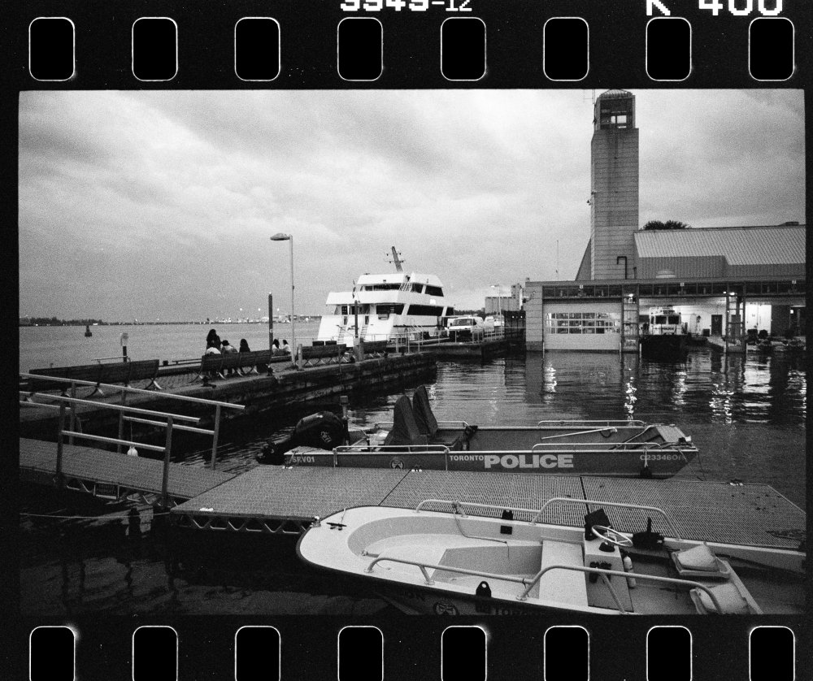
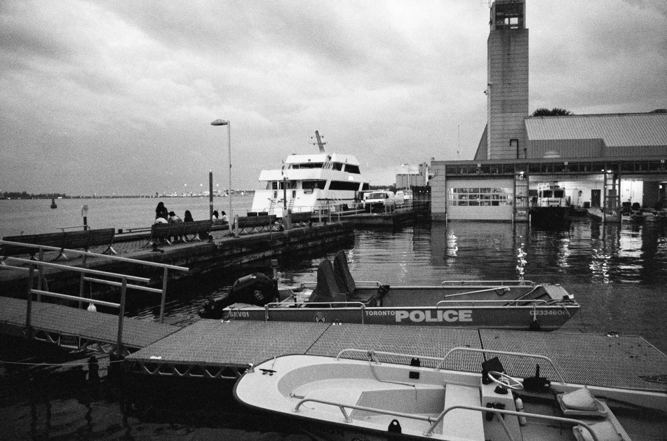
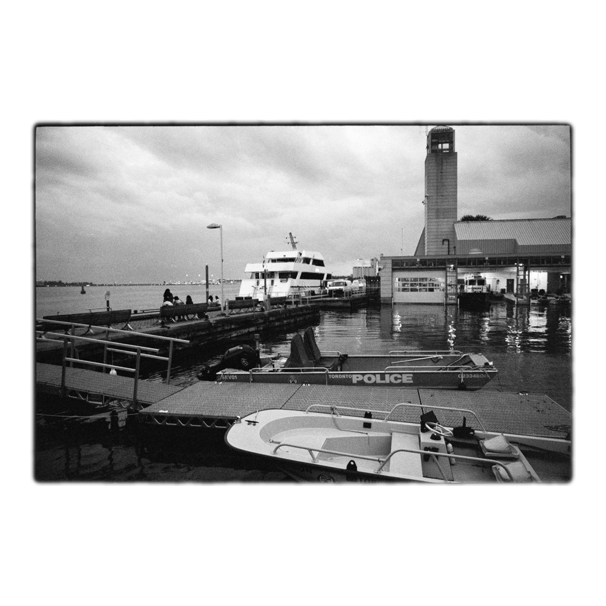
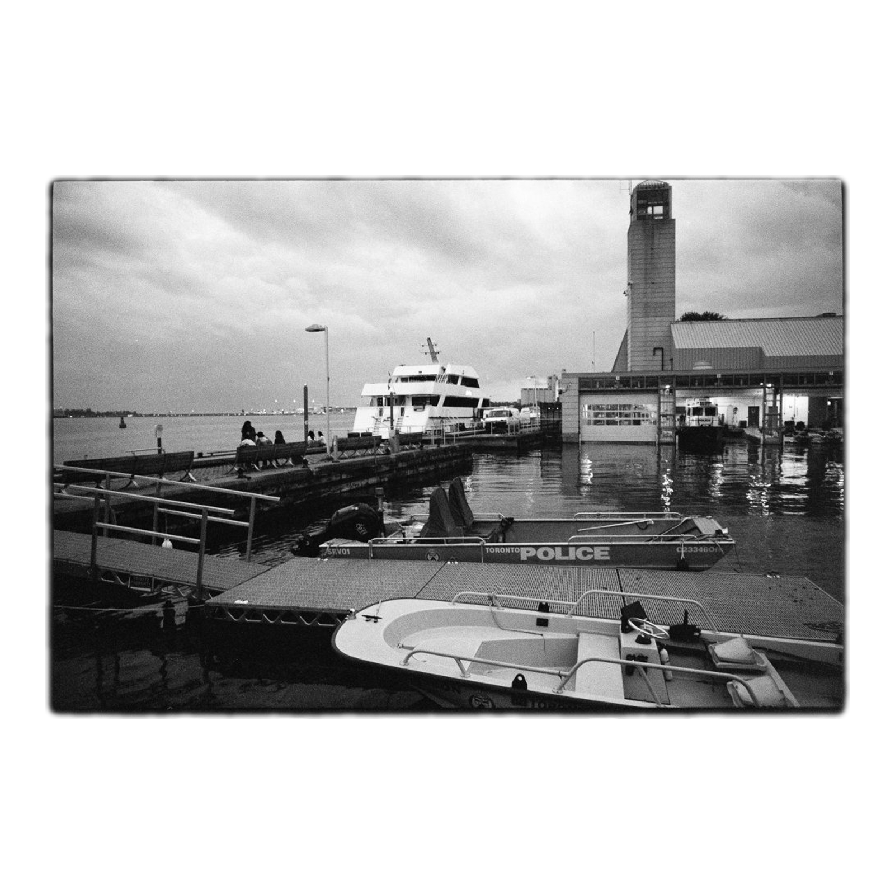
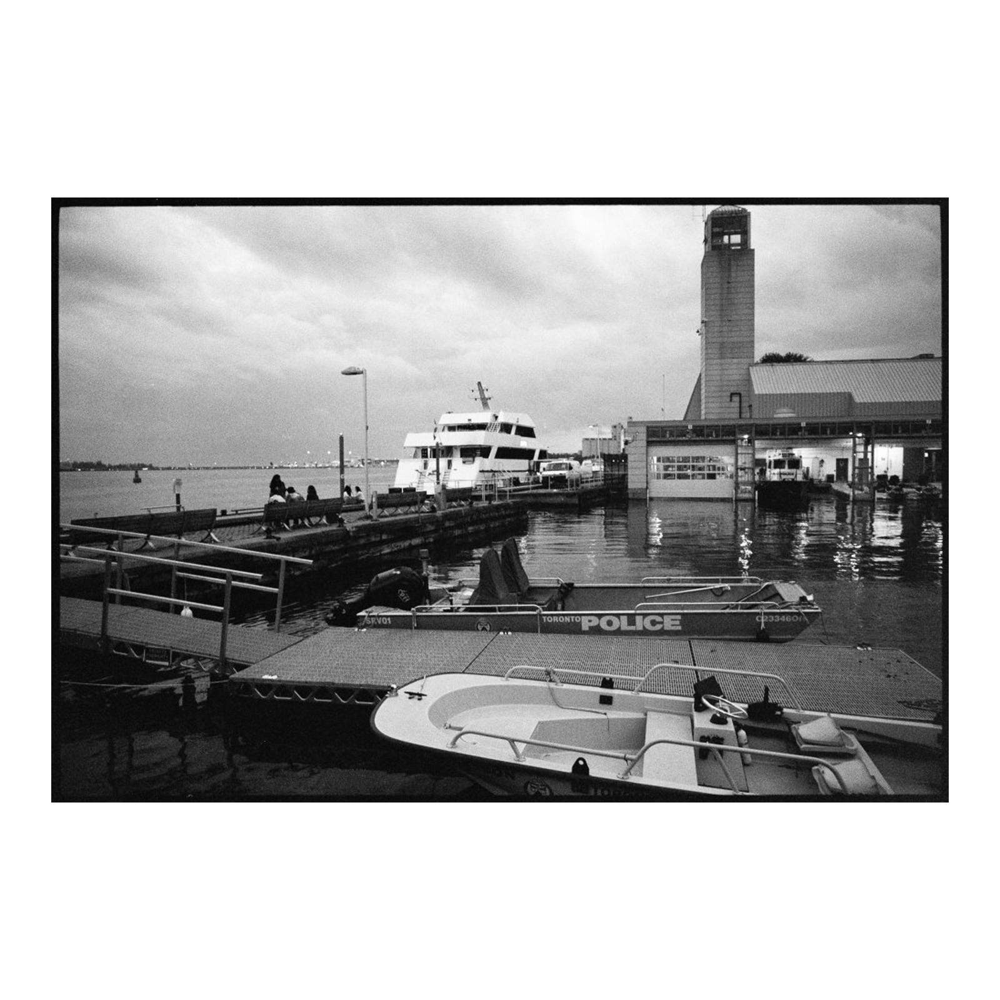
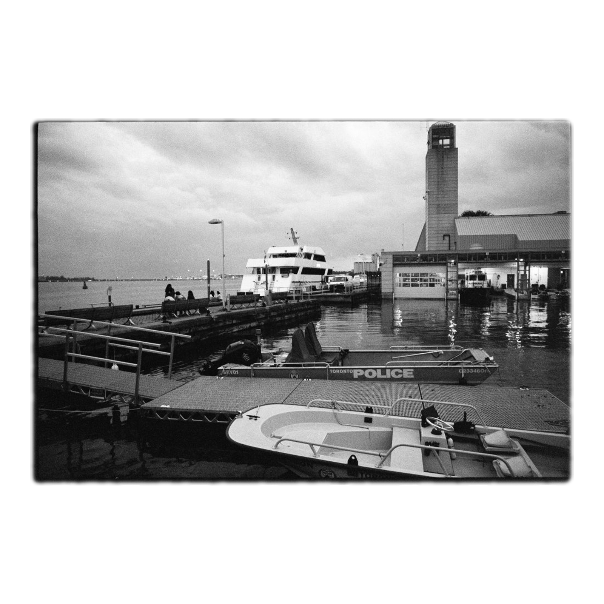
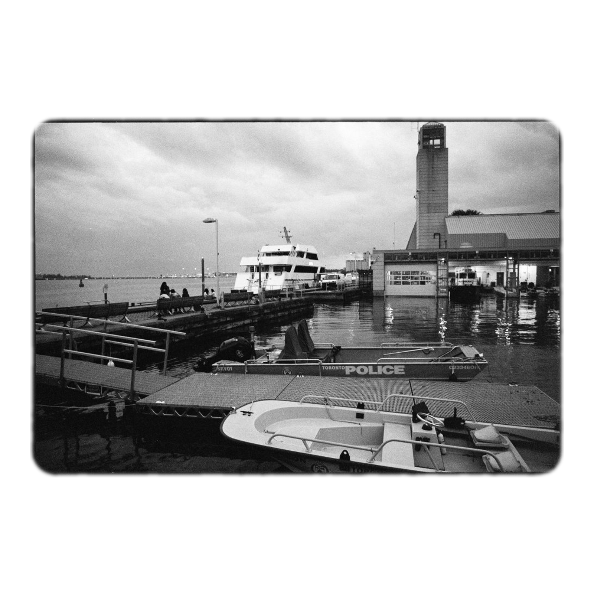

# rebate

Takes DSLR scans of 35mm film shot "with full sprockets" (already-positive /
inverted) and produces bordered scans: the real frame + its natural film
rebate border, rounded corners with soft/irregular edges, on a white canvas.

The look mimics the classic Fuji Frontier "border" scan (frame + unexposed
film border on white), but it's built from the real border in your scan rather
than a drawn frame.

By default the output is at **native resolution** (no resampling, no quality
loss) — typically ~6300x4500px.

## Examples

Input (full-sprocket DSLR scan) and the two main outputs:

| Input | Bordered (default) | Plain (no border) |
|---|---|---|
|  |  |  |

### Variations on the same scan

| Natural (3 different seeds) | Extremes |
|---|---|
|  |  |
|  |  |
|  |  |

Left column: the default bordered look — the three images use identical
settings, only a different random seed. Right column, top to bottom: sprocket
slivers forced (`--sprocket-chance 1`), no rounding/no texture
(`--radius 0 --roughness 0 --feather 0`), and very rounded corners
(`--radius 0.06 --radius-jitter 0`).

## Run

The script is executable and pins `/opt/homebrew/bin/python3.11` (which has
OpenCV + numpy — the default `python3` on this Mac is 3.14 and does not):

```bash
./rebate.py scans/*.jpg --out ./out
```

Single file:

```bash
./rebate.py SAMPLE.jpg --out ./out --debug
```

Or explicitly:

```bash
/opt/homebrew/bin/python3.11 rebate.py SAMPLE.jpg --out ./out
```

## Configs (presets)

Save a fixed combination of flags under a name and reuse it with
`--config NAME`. Configs are stored per user in
`~/.config/rebate/configs.json` (override the location with
`REBATE_CONFIG_FILE`).

```bash
# Save the exact combination you use for Instagram:
./rebate.py config save instagram --quality 100 --border 0.035 --size 3000

# Apply it (input files and --out are not part of a config):
./rebate.py Photos-1-001/*.jpg --out /tmp/foo --config instagram

# Explicit flags always override the saved values:
./rebate.py Photos-1-001/*.jpg --out /tmp/foo --config instagram --size 1600
```

Manage configs:

```bash
./rebate.py config list          # names
./rebate.py config show NAME     # one config's flags
./rebate.py config rename OLD NEW
./rebate.py config delete NAME
```

A config stores only the flags you actually pass at save time (not the
built-in defaults, and never `--out` or the input files), so it stays a
minimal "combination" and keeps working even if a default changes later.

## Options

| flag          | default         | meaning                                                  |
|---------------|-----------------|----------------------------------------------------------|
| `--out`       | `.`             | output directory                                         |
| `--config`    | —               | named config/preset to apply; explicit flags override saved values (see **Configs**) |
| `--size`      | `0`             | square canvas size; `0` = native resolution (recommended)|
| `--margin`    | `0.05`          | white margin around the crop (fraction)                  |
| `--border`    | `0.025`         | film border kept around the gate (fraction of gate height)|
| `--radius`    | `0.015`         | corner radius (fraction of final crop size)              |
| `--radius-jitter` | `0`          | random +/- variation of corner radius (fraction; 0 = fixed corners) |
| `--square-corner-chance` | `0.2` | chance (0-1) that one corner, or two corners on the same side, are squared off instead of rounded |
| `--border-jitter` | `0.6`        | random shift of the black film border, as a fraction of the border thickness (0 = perfectly even). Forced to `0` automatically when any `--offset-*` is used |
| `--roughness` | `1.0`           | edge irregularity in px (0 = perfectly straight)         |
| `--feather`   | `3.0`           | edge softness in px (0 = hard edge)                      |
| `--sprocket-chance` | `0.7`      | chance (0-1) a tiny sliver of sprockets is visible, on at most one side (top or bottom) |
| `--max-sprocket-border` | `0.03` | max rebate (fraction of gate height) that still shows a sprocket sliver; beyond it the crop keeps a small plain border |
| `--offset-left` / `--offset-right` / `--offset-top` / `--offset-bottom` | `0` | manual nudge of one crop edge, in pixels at full scan resolution; positive reveals more of that side, negative trims it inward. Deterministic and applied to the final crop, so each flag only ever moves its own edge. Use when the detector occasionally cuts a sliver off one edge |
| `--offset-x` / `--offset-y` | unset | shorthand: set **both** left+right (`--offset-x`) or **both** top+bottom (`--offset-y`) at once. A specific edge flag wins if also given. Passing any `--offset-*` with a non-zero `--border-jitter` is an error (the script exits); otherwise `--border-jitter` is forced to `0` |
| `--seed`      | random          | random seed for edge texture (for reproducibility)       |
| `--quality`   | `100`           | JPEG quality 1-100                                       |
| `--plain`     | off             | crop just the 3:2 image, no border, no white canvas      |
| `--debug`     | off             | also save an annotated debug image                       |
| `--suffix`    | `.bordered.jpg` | output filename suffix (use `.png` for lossless)         |

### What are "seeds"?

The bordered look has a few random details — the edge texture/roughness, the
corner rounding amount, whether some corners are squared off, and whether a
tiny sprocket sliver shows. A **seed** is
just the random number that picks those details.

- Same settings, **different seed** → a slightly different (but equivalent) look.
- Same settings, **same seed** → identical output every run.

`N` is just any whole number (an integer) — `--seed 1`, `--seed 42`, `--seed
999` all work and the number itself means nothing. It only sets the starting
point of the random generator, so a given number always replays the same
random details. Pass `--seed N` to lock a look you like; leave it out and
every run is a fresh roll of the dice.

## Plain crop (no border)

Add `--plain` to output just the 3:2 image with no film border and no white
canvas (at native resolution):

```bash
./rebate.py .../*.jpg --out ./out --plain --suffix .plain.jpg
```


## Portrait / vertical shots

Two different situations are handled:

1. **Vertical photo inside a landscape scan** (camera held sideways): works
   as-is — a 35mm frame is always 36x24mm (landscape), so the script crops the
   landscape frame correctly even if the content is rotated 90° inside it.
2. **The whole scan file is portrait** (someone already rotated it 90° to view
   it upright): the script now auto-detects this, rotates it in memory to
   landscape for detection, processes normally, then rotates the output back
   to portrait. The original file is never modified.

## How it works

Detection is scale-invariant — it derives everything from the film's physical
geometry (36x24mm frame, 4.75mm sprocket pitch) rather than hard-coded pixel
sizes, so it works on scans of any resolution and on negative, B&W and
positive (slide) film.

1. Looks for sprocket holes in the outer bands and fits them to the periodic
   ~4.75mm grid to learn the scan scale (pitch in px) and the two sprocket
   rows, discarding dust and photo content.
2. Finds the exposed 36x24mm gate either as the bright/textured region between
   the sprocket rows, or (for dark/underexposed frames) from the pitch-implied
   3:2 geometry centred between the rows.
3. If no usable sprockets are present (holes cropped off), falls back to a
   brightness/texture step over the whole strip, cross-checked against the
   expected 3:2 height.
4. Horizontal centre from the sprocket holes (top/bottom cross-checked).
5. Crops the gate plus a thin band of the real unexposed film border (and,
   with `--sprocket-chance`, occasionally dips a tiny sliver of sprocket
   holes on at most one randomly-chosen side — only when that side's rebate
   is thin enough that the border stays small; see `--max-sprocket-border`).
6. Applies a rounded, slightly wavy, feathered edge and pastes onto a white
   canvas at native resolution.

Requires: `opencv-python-headless` and `numpy`.

## Tests

```bash
/opt/homebrew/bin/python3.11 -m unittest discover -s tests -p 'test_*.py'
```
